## 15.1. Limpieza y mantenimiento físico del PC

En esta unidad aprenderás a limpiar un equipo de forma segura y eficaz, sin dañar sus componentes. La limpieza física alarga la vida útil del PC, mantiene las temperaturas bajo control y reduce el ruido causado por el polvo y los ventiladores desgastados.

## Objetivos de aprendizaje

- Explicar por qué es necesario limpiar un equipo y qué tipos de mantenimiento existen.
- Aplicar las normas de seguridad antes de manipular el interior de un PC.
- Seleccionar las herramientas y los productos de limpieza adecuados, y reconocer los que están prohibidos.
- Realizar la limpieza exterior e interior de un equipo, incluido el disipador y la pasta térmica.
- Limpiar y lubricar ventiladores, y comprobar el equipo tras el mantenimiento.

---

### 1. Introducción

#### 1.1. Por qué hay que limpiar un equipo: polvo, temperatura, ruido y vida útil

El polvo es uno de los principales enemigos del PC. Una capa de polvo sobre el disipador o en las rejillas dificulta la salida del calor, por lo que el procesador y la tarjeta gráfica trabajan a mayor temperatura. Esa temperatura elevada puede provocar reducciones de rendimiento y, con el tiempo, un desgaste prematuro de los componentes.

Además, el polvo se acumula en las aspas de los ventiladores y en sus rodamientos, lo que aumenta el ruido y puede llevar a un fallo del ventilador. Un equipo limpio funciona más frío, más silencioso y durante más tiempo.

<figure markdown="span">
  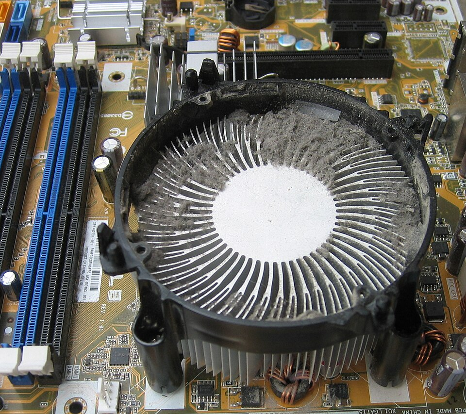{ style="max-width: 70%; height: auto;" }
  <figcaption>Disipador de un procesador con polvo acumulado entre las aletas, que impide la salida del calor. Foto: Hans Haase, CC BY-SA 4.0.</figcaption>
</figure>

#### 1.2. Mantenimiento preventivo y correctivo

- **Mantenimiento preventivo:** conjunto de tareas que se realizan de forma periódica para evitar averías, como la limpieza, la revisión de conexiones o la actualización del firmware.
- **Mantenimiento correctivo:** intervención que se realiza cuando el equipo ya presenta un fallo, como sustituir un ventilador averiado o una fuente de alimentación defectuosa.

La limpieza física es una tarea preventiva. Realizarla con regularidad evita que un problema menor se convierta en una avería que obligue a una intervención correctiva.

#### 1.3. Normas de seguridad: desconexión, electricidad estática, ventilación y productos inflamables

Antes de tocar el interior de un equipo deben cumplirse estas normas básicas:

- **Desconexión:** apaga el equipo, desconecta el cable de alimentación de la red y espera unos minutos antes de abrir la carcasa.
- **Electricidad estática:** utiliza una pulsera antiestática conectada a una toma de masa, y evita tocar los contactos de los componentes con las manos desnudas.
- **Ventilación:** trabaja en una zona bien ventilada, sobre una superficie limpia y seca.
- **Productos inflamables:** los alcoholes y los aerosoles son inflamables. No los uses cerca de fuentes de calor ni de llamas, y guárdalos cerrados.

> Un equipo desconectado de la red puede conservar carga en algunos condensadores. Por eso, la desconexión completa del cable de alimentación es la primera medida de seguridad.

---

### 2. Herramientas y productos de limpieza

#### 2.1. Herramientas: brochas antiestáticas, bastoncillos, paños de microfibra, pulsera antiestática y lupa

- **Brochas antiestáticas:** eliminan el polvo de zonas delicadas sin generar cargas electrostáticas.
- **Bastoncillos:** permiten llegar a las esquinas y a los huecos de los componentes. Deben estar humedecidos solo con el producto adecuado.
- **Paños de microfibra:** no sueltan pelusa y son ideales para limpiar superficies sin rayarlas.
- **Pulsera antiestática:** descarga la electricidad estática del cuerpo antes de tocar los componentes.
- **Lupa:** ayuda a inspeccionar conectores, condensadores y soldaduras para detectar daños o acumulaciones de suciedad.

<figure markdown="span">
  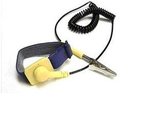{ style="max-width: 60%; height: auto;" }
  <figcaption>Pulsera antiestática con cable y pinza para conectarla a masa. Foto: Hopeespe, CC BY-SA 3.0.</figcaption>
</figure>

<figure markdown="span">
  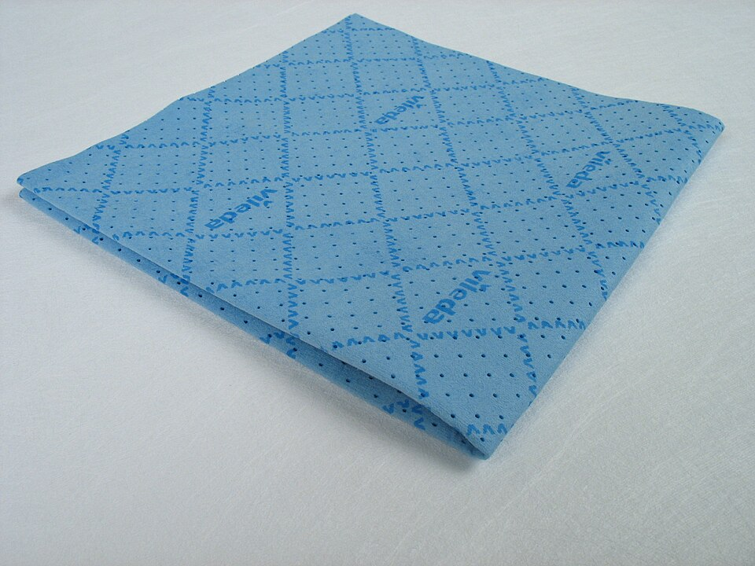{ style="max-width: 50%; height: auto;" }
  <figcaption>Paño de microfibra, que no suelta pelusa y es adecuado para limpiar sin rayar. Foto: Polyesterchen, dominio público.</figcaption>
</figure>

<figure markdown="span">
  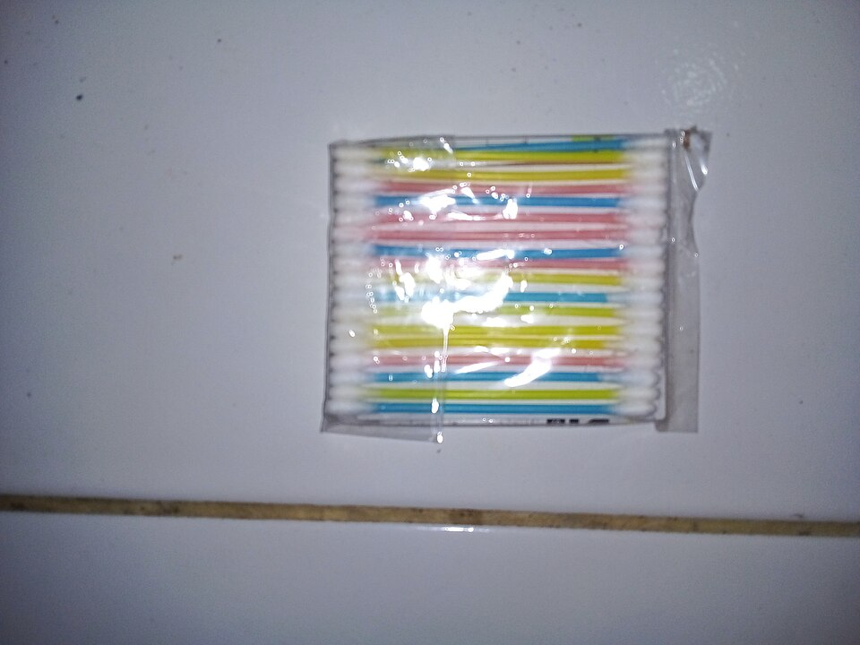{ style="max-width: 50%; height: auto;" }
  <figcaption>Bastoncillos de algodón para llegar a los huecos y las esquinas de los componentes. Foto: SATELIT BM, CC BY-SA 4.0.</figcaption>
</figure>

#### 2.2. Aire comprimido y sopladores

El aire comprimido se usa para desalojar el polvo de disipadores, rejillas y ranuras. Debe emplearse con las siguientes precauciones:

- Usa un bote de aire comprimido o un compresor con filtro de agua y aceite. Un compresor sin filtro puede introducir humedad o aceite en el equipo.
- Sujeta siempre el ventilador antes de soplar, para evitar que gire a una velocidad superior a la que soporta.
- Mantén el bote en posición vertical. Si lo inclinas, puede salir líquido propelente sobre los componentes.
- Sopla a una distancia prudente y en pequeños impulsos, sin acercar la boquilla a los contactos.

#### 2.3. Alcohol isopropílico: concentraciones y usos

El alcohol isopropílico, también llamado IPA, es el producto más utilizado para limpiar placas y disipadores, porque se evapora rápido y no deja residuos. Según los fabricantes, para componentes electrónicos se recomienda una concentración alta:

- **99 % o superior:** es la opción habitual en electrónica, porque se seca antes y deja menos agua sobre la placa.
- **70 %:** contiene un 30 % de agua. Se evapora más despacio y resulta útil para desinfección general, pero no es la primera opción para placas base.

No debe usarse alcohol etílico ni otros alcoholes domésticos, ya que pueden dejar residuos o contener aditivos. Aplica el alcohol con un paño o un bastoncillo, sin empapar la placa.

<figure markdown="span">
  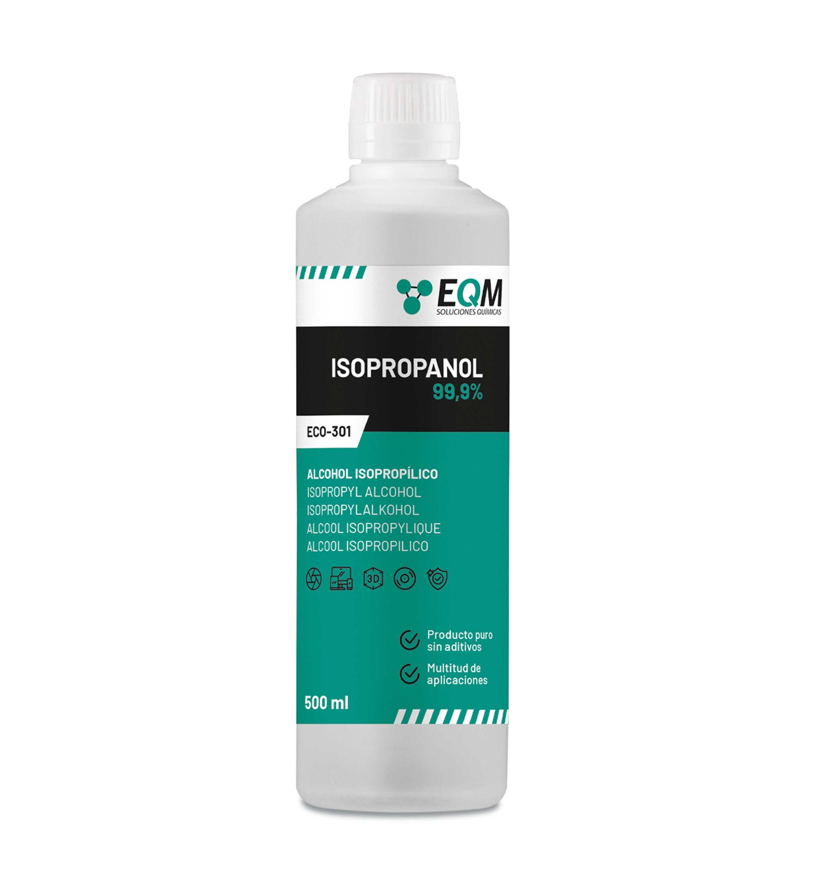{ style="max-width: 50%; height: auto;" }
  <figcaption>Bote de alcohol isopropílico de 500 ml con una pureza del 99,9 %, como el que se recomienda para limpiar placas. Imagen de EQM Soluciones Químicas, con uso sujeto a autorización del titular.</figcaption>
</figure>

#### 2.4. Limpiador de contactos

El limpiador de contactos es un producto dieléctrico, es decir, no conduce la electricidad. Sirve para eliminar la oxidación y la suciedad de conectores, ranuras de memoria y contactos de tarjetas. Se diferencia de un lubricante en que no deja una película que pueda interferir con la conexión eléctrica.

Antes de conectar de nuevo los componentes, deja que el producto se seque por completo.

#### 2.5. Espumas limpiadoras: solo para superficies externas

Las espumas limpiadoras se utilizan solo en la carcasa, los paneles externos y los periféricos. Nunca deben aplicarse sobre la placa base, los componentes internos ni los conectores, porque pueden dejar residuos que afecten al contacto eléctrico.

#### 2.6. Productos prohibidos: agua del grifo, limpiadores domésticos, amoníaco y WD-40

No debes usar los siguientes productos en un equipo:

- **Agua del grifo:** contiene minerales y sales que pueden formar depósitos conductores y dañar los componentes.
- **Limpiadores domésticos:** muchos contienen detergentes, perfumes o disolventes que dejan residuos o dañan los plásticos y las soldaduras.
- **Amoníaco:** puede corroer los contactos metálicos y dañar componentes sensibles.
- **WD-40:** es un desengrasante y desplazador de humedad, no un lubricante adecuado para electrónica. Además, puede dejar una película que atrae el polvo y perjudicar los contactos. Para limpiar contactos, utiliza un limpiador específico y, para lubricar ventiladores, un aceite ligero indicado para ello.

---

### 3. Limpieza general del equipo

#### 3.1. Limpieza exterior: carcasa, rejillas y periféricos

Antes de abrir el equipo, limpia la parte exterior:

1. Retira el polvo de la carcasa con un paño de microfibra ligeramente humedecido con agua desionizada o con una espuma limpiadora.
2. Limpia las rejillas de entrada y salida de aire con una brocha o con aire comprimido, y aspira el polvo de las zonas accesibles sin acercar la boquilla a los componentes.
3. Limpia el teclado, el ratón y la pantalla con un paño seco o con una toallita específica, sin aplicar líquido directamente sobre ellos.

#### 3.2. Limpieza interior: placa base, ranuras y conectores

Con el equipo abierto y la pulsera colocada:

- Sopla el polvo de la placa base, las ranuras y los conectores con aire comprimido, siguiendo las precauciones del apartado 2.2.
- Usa una brocha antiestática para retirar el polvo que no se desaloja con el aire.
- Limpia los contactos de las ranuras de memoria y de expansión con un limpiador de contactos y un bastoncillo.
- Comprueba que no haya restos de cables o de pegatinas sueltas que puedan generar un cortocircuito.

#### 3.3. Disipador del procesador y cambio de pasta térmica

El disipador transfiere el calor del procesador al aire. Con el tiempo, la pasta térmica pierde eficacia y el polvo se adhiere a las aletas. Para limpiarlo y renovar la pasta:

1. Retira el disipador siguiendo el procedimiento del fabricante, sin hacer palanca sobre el procesador.
2. Limpia el procesador (IHS) y la base del disipador con un paño sin pelusa y alcohol isopropílico de 90 % o más. Haz movimientos circulares y añade alcohol si quedan restos.
3. Usa bastoncillos para los bordes y las zonas de difícil acceso.
4. Espera unos minutos a que las superficies se sequen por completo.
5. Aplica una cantidad pequeña de pasta térmica nueva, del tamaño de un guisante, en el centro del procesador.
6. Vuelve a montar el disipador, presionando en cruz según el fabricante, y conecta el ventilador.

<figure markdown="span">
  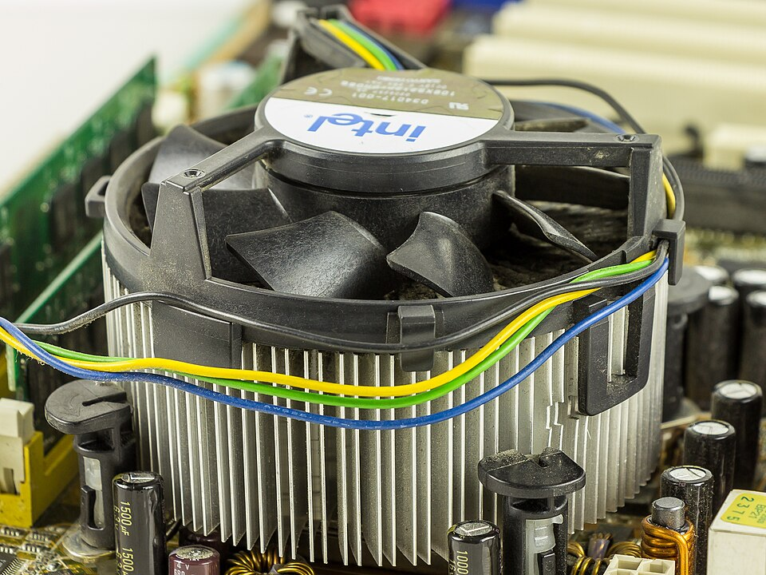{ style="max-width: 60%; height: auto;" }
  <figcaption>Disipador de procesador con su ventilador. Las aletas se limpian con aire comprimido y brocha, y la base se limpia tras retirarlo. Foto: Raimond Spekking, CC BY-SA 4.0.</figcaption>
</figure>

> Si el disipador lleva un ventilador, sujeta sus aspas al limpiarlo y no lo hagas girar en seco.

#### 3.4. Fuente de alimentación: qué se puede hacer y qué no

La fuente de alimentación contiene condensadores que pueden conservar carga eléctrica peligrosa incluso después de desconectarla. Por ello:

- **Sí se puede:** limpiar las rejillas y el exterior de la fuente, y soplar el polvo de sus rejillas con aire comprimido sin abrirla.
- **No se puede:** abrir la fuente ni manipular su circuito interior, salvo que se trate de un técnico cualificado con el equipo adecuado.

#### 3.5. Pastas térmicas: función, tipos y características

##### 3.5.1. Función

La superficie del procesador y la base del disipador nunca son perfectamente planas. Entre ambas quedan microscópicos huecos llenos de aire, que es un mal conductor del calor. La pasta térmica rellena esos huecos y sustituye el aire por un material que transmite mejor el calor. No enfría por sí misma: mejora la transferencia de calor del procesador al disipador.

##### 3.5.2. Tipos

Los fabricantes clasifican las pastas según su composición. La tabla resume los tipos más habituales:

| Tipo | Composición | Conductividad orientativa | Conductividad eléctrica | Observaciones |
|---|---|---|---|---|
| Silicona | Aceite de silicona, con o sin partículas | Baja (en torno a 1 W/mK en algunos productos) | No conductora | Económica; rendimiento limitado. |
| Cerámica | Partículas cerámicas o de óxido en base de silicona | De 2 a 11 W/mK, según el producto | No conductora | Opción económica y muy extendida. |
| Metálica | Partículas metálicas (por ejemplo, óxido de zinc o de cobre) en base de silicona | De 4 a 13 W/mK; muchas rondan de 8 a 11 | Depende de la composición: algunas conducen la electricidad | Opción intermedia para equipos de gama media y alta. |
| Carbono | Micropartículas de carbono | Del orden de 8,5 W/mK en algunos productos (dato de tiendas) | No conductora según el fabricante | Ejemplo: Arctic MX-4. |
| Metal líquido | Aleación de metales | Muy alta: hasta unos 80 W/mK según fabricantes | Conductora | Difícil de aplicar; riesgo de cortocircuito si se derrama. |
| Pads térmicos | Silicona sólida con cargas térmicas | Muy variable según el fabricante | No conductores en general | No son pastas: rellenan huecos de espesor definido. |

<figure markdown="span">
  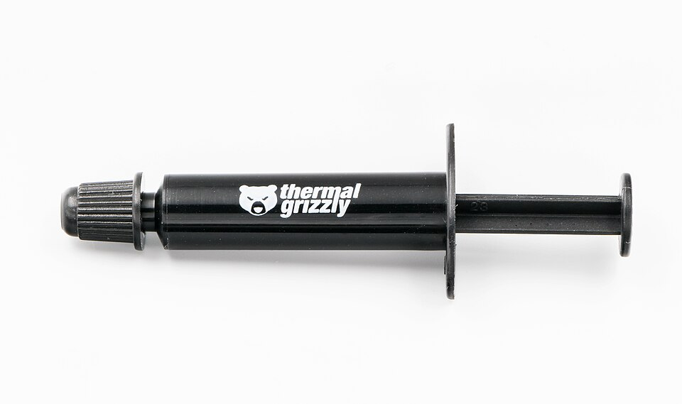{ style="max-width: 60%; height: auto;" }
  <figcaption>Jeringa de pasta térmica Kryonaut, de la marca Thermal Grizzly, como ejemplo de presentación comercial. Foto: Jacek Halicki, CC BY-SA 4.0.</figcaption>
</figure>

<figure markdown="span">
  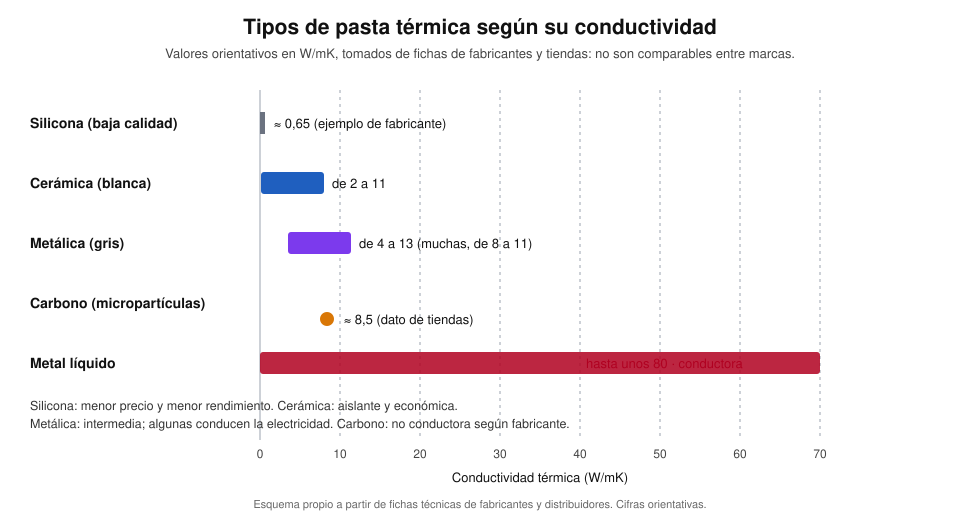{ style="max-width: 100%; height: auto;" }
  <figcaption>Conductividad térmica orientativa de cada tipo de pasta, en W/mK. Las cifras proceden de fichas de fabricantes y distribuidores, así que no son comparables entre marcas.</figcaption>
</figure>

> Las cifras de conductividad varían mucho según la fuente y el método de medida. Para comparar dos pastas, consulta las fichas técnicas del mismo fabricante.

##### 3.5.3. Características que hay que valorar

- **Conductividad térmica (W/mK):** indica lo bien que transmite el calor. Es la cifra más citada, pero no basta por sí sola.
- **Conductividad eléctrica:** una pasta conductora puede causar cortocircuitos si se derrama sobre pistas o condensadores cercanos al socket.
- **Viscosidad y facilidad de aplicación:** las pastas más densas se mantienen donde se aplican; las muy fluidas se extienden y pueden escurrirse.
- **Durabilidad:** con el tiempo y el calor, la pasta se reseca o se separa, y pierde eficacia. Algunas guías recomiendan revisarla cada 2 o 3 años, o cuando aumenten las temperaturas.
- **Rango de temperaturas:** el fabricante indica la temperatura de trabajo de cada producto.
- **Compatibilidad con los materiales:** algunas pastas metálicas no son adecuadas para disipadores de aluminio.
- **Presentación:** jeringa, tubo o sobre, según la cantidad y el uso.

##### 3.5.4. Aplicación

Aplica una cantidad pequeña, del tamaño de un guisante, en el centro del procesador. Al presionar el disipador, la pasta se extiende por la superficie. Un exceso no mejora la transferencia de calor, sino que puede escurrirse hacia los bordes y ensuciar la placa.

<figure markdown="span">
  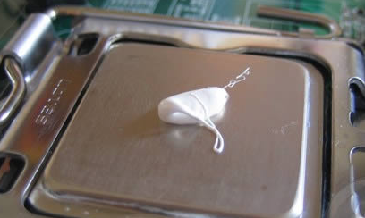{ style="max-width: 70%; height: auto;" }
  <figcaption>Pasta térmica aplicada en el centro de un procesador, con una cantidad adecuada. Imagen de Toniperis, CC BY-SA 3.0.</figcaption>
</figure>

<figure markdown="span">
  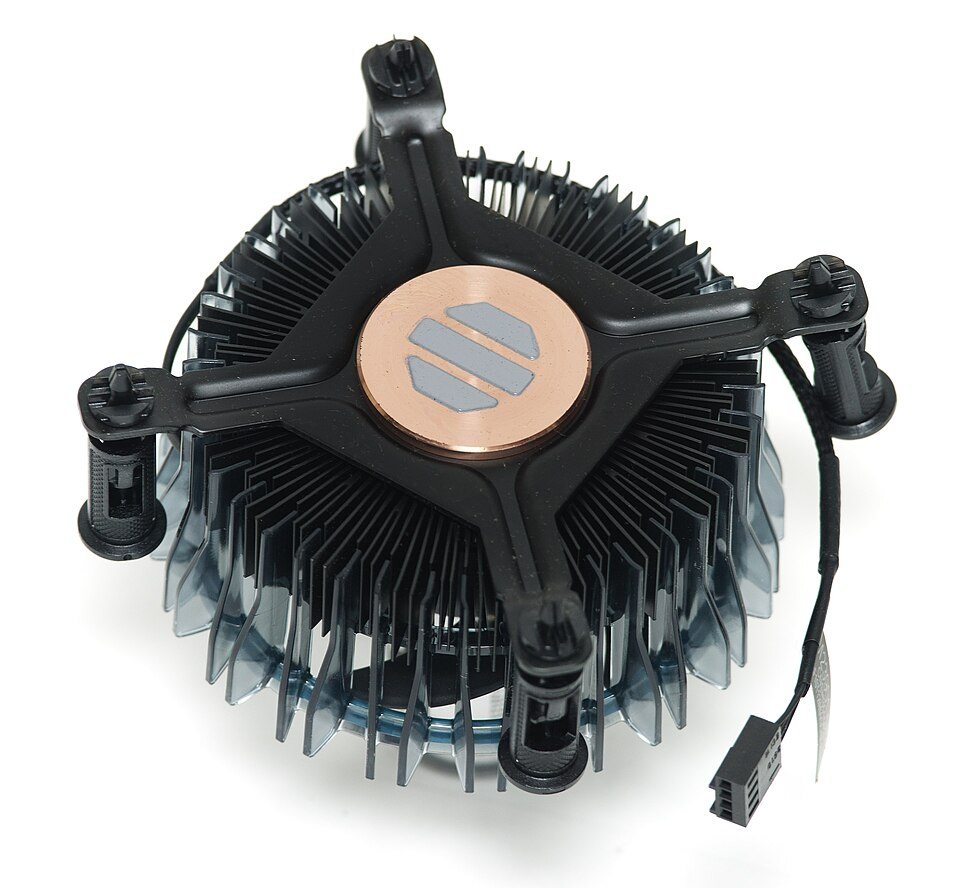{ style="max-width: 70%; height: auto;" }
  <figcaption>Disipador con pasta térmica precargada de fábrica. Antes de montarlo hay que retirar la pasta, o limpiarla y reaplicarla, según el caso. Foto: Ashley Pomeroy, CC BY 4.0.</figcaption>
</figure>

<figure markdown="span">
  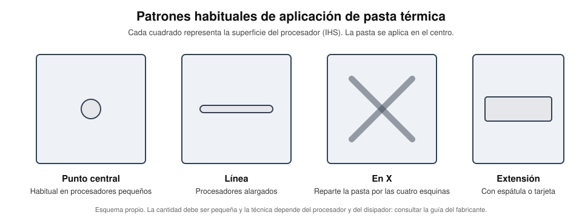{ style="max-width: 100%; height: auto;" }
  <figcaption>Patrones habituales de aplicación. El punto central es el más extendido en procesadores pequeños; la técnica concreta depende del procesador y del disipador.</figcaption>
</figure>

##### 3.5.5. Pads térmicos

Los pads térmicos son láminas sólidas que se colocan entre un componente y su disipador. Se usan sobre todo en memorias, reguladores de tensión (VRM) y SSD M.2, donde los huecos son de un espesor definido y la pasta no sería práctica. En la CPU se suele usar pasta, porque se adapta mejor a las microirregularidades.

Los pads deben quedar ligeramente comprimidos, sin forzar la placa ni los tornillos. Un pad demasiado fino no rellena bien un hueco grande.

##### 3.5.6. Precauciones

- Retira la pasta antigua por completo antes de aplicar una nueva (apartado 3.3).
- No mezcles pastas de distintos tipos o marcas, salvo que el fabricante lo indique.
- Evita que la pasta llegue a los contactos del socket o a los condensadores cercanos.
- El metal líquido requiere experiencia y protección de las zonas cercanas. Para el alumnado, lo prudente es usar pastas no conductoras.

---

### 4. Limpieza por ultrasonidos

#### 4.1. Qué es y cómo funciona: la cavitación

La limpieza por ultrasonidos utiliza un baño de líquido en el que un transductor genera ondas sonoras de alta frecuencia. Estas ondas crean pequeñas burbujas de vacío que implosionan al colapsar y desprenden la suciedad de las superficies. Este fenómeno se llama **cavitación**.

<figure markdown="span">
  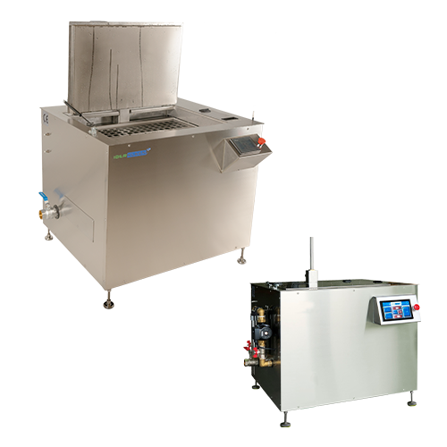{ style="max-width: 70%; height: auto;" }
  <figcaption>Máquinas industriales de limpieza por ultrasonidos. Son equipos de gran tamaño, diseñados para piezas metálicas en talleres y no para placas montadas. Imagen: Eph2024, CC0.</figcaption>
</figure>

Para ver el proceso de limpieza por ultrasonidos aplicado a placas de circuito impreso, puedes consultar el vídeo [Ultimate Guide to Ultrasonic Cleaning PCBs](https://www.youtube.com/watch?v=fNQJNi2i1Mc), del canal nanofix. Es un vídeo de un fabricante y patrocinado, por lo que conviene contrastar sus recomendaciones con las de este apartado.

<figure markdown="span">
  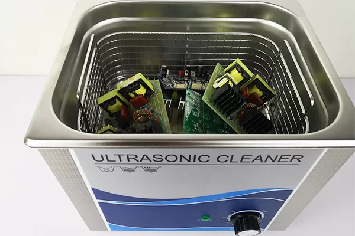{ style="max-width: 70%; height: auto;" }
  <figcaption>Placas de circuito impreso en la cesta de una cuba de ultrasonidos. Imagen de IPCB, con uso sujeto a autorización del titular.</figcaption>
</figure>

#### 4.2. Cuándo usarla: líquidos derramados, corrosión y suciedad incrustada

La limpieza por ultrasonidos resulta útil en casos concretos, por ejemplo:

- Piezas que han sufrido un derrame de líquido.
- Componentes con corrosión superficial.
- Piezas metálicas con suciedad incrustada en huecos difíciles de alcanzar.

Su uso sobre placas base montadas es controvertido, porque el baño puede dañar componentes sensibles o retener humedad en zonas de difícil secado. Por eso debe aplicarse solo cuando no exista otra solución y siguiendo las indicaciones del fabricante de la placa y del equipo de ultrasonidos.

#### 4.3. Líquidos y mezclas para la cuba

En la cuba se utilizan soluciones a base de agua con un detergente neutro, sin amoníaco ni disolventes. Los fabricantes de equipos de ultrasonidos advierten de que no deben usarse disolventes inflamables, como el alcohol o la gasolina, en la cuba.

#### 4.4. Componentes que no deben entrar en la cuba

Como criterio prudente, no deben introducirse en la cuba:

- Ventiladores, porque sus rodamientos pierden lubricante y no se secan bien.
- Discos duros mecánicos y unidades ópticas.
- Pilas, como la pila CMOS, y componentes con etiquetas o adhesivos que puedan despegarse.
- Fuentes de alimentación.
- Cables, conectores de plástico y elementos con partes de goma o de plástico sensible.

Antes de decidir qué piezas se pueden limpiar, consulta el manual de la placa y del componente.

#### 4.5. Parámetros de trabajo: frecuencia, temperatura y duración de los ciclos

Las frecuencias bajas, en torno a 20 a 40 kHz, son más agresivas y se usan para suciedad resistente en piezas robustas. Las frecuencias más altas resultan más suaves y se emplean con piezas delicadas. Para componentes electrónicos conviene usar una frecuencia suave y ciclos cortos, con una temperatura moderada, siempre dentro de los límites que indique el fabricante del líquido y del equipo.

#### 4.6. Procedimiento paso a paso

1. Retira las piezas que no deben entrar en la cuba y limpia previamente el polvo grueso con aire comprimido.
2. Llena la cuba con la solución indicada por el fabricante, hasta el nivel marcado.
3. Introduce la pieza sobre una rejilla, sin que toque el fondo de la cuba.
4. Programa un ciclo corto, de unos pocos minutos, y revisa la pieza al terminar.
5. Repite el ciclo si es necesario, dejando enfriar la solución entre ciclos.

#### 4.7. Aclarado y secado

Después de la limpieza, aclara la pieza con agua desionizada para eliminar los restos de detergente. A continuación, sécala al aire sobre una superficie limpia. Nunca conectes una pieza húmeda, y deja que se seque por completo según el tiempo que indique el fabricante.

#### 4.8. Inspección final

Antes de volver a montar la pieza, revisa con la lupa los conectores, las soldaduras y los componentes. Comprueba que no quedan restos de líquido, de detergente ni de suciedad. Si detectas corrosión o daños, sustituye la pieza en lugar de intentar usarla.

---

### 5. Ventiladores

#### 5.1. Tipos de rodamiento: casquillo y bolas

- **Rodamiento de casquillo (sleeve):** el eje gira sobre una superficie de cojinete lubricada. Es más económico, pero se desgasta antes y es más sensible a la orientación del ventilador.
- **Rodamiento de bolas (ball):** el eje gira sobre pequeñas bolas metálicas. Es más duradero, tolera mejor distintas posiciones de montaje y tiene un funcionamiento más silencioso a largo plazo.

#### 5.2. Limpieza: por qué hay que sujetar las aspas

Al limpiar un ventilador, sujeta siempre las aspas con los dedos o con una pieza de apoyo. Si las dejas girar libremente, el ventilador puede girar a una velocidad superior a la que soporta su rodamiento, lo que provoca desgaste, daños en el eje o incluso la rotura de las aspas.

<figure markdown="span">
  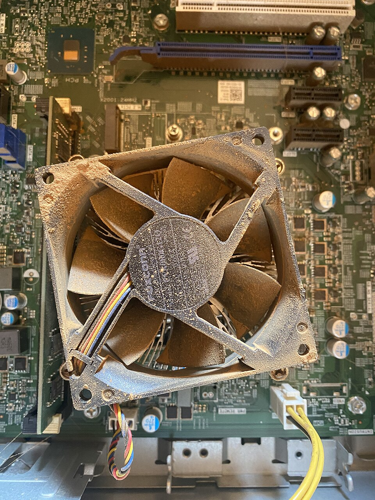{ style="max-width: 60%; height: auto;" }
  <figcaption>Ventilador de ordenador con polvo acumulado en las aspas y la rejilla. Foto: B722N, CC BY-SA 4.0.</figcaption>
</figure>

Para limpiar el ventilador, retira el polvo de las aspas con un paño o un bastoncillo húmedo con alcohol isopropílico y sopla el resto con aire comprimido, sujetando el ventilador.

#### 5.3. Lubricación: aceite adecuado y procedimiento

La lubricación solo es necesaria en ventiladores con rodamiento de casquillo. Para lubricarlos:

1. Retira la pegatina de la parte superior del ventilador, si existe, para acceder al orificio del eje.
2. Aplica una o dos gotas de un aceite ligero indicado para ventiladores o máquinas de precisión.
3. Gira el ventilador a mano para repartir el aceite y limpia el exceso con un paño seco.
4. Vuelve a colocar la pegatina solo si el fabricante lo indica.

No uses WD-40 ni aceites pesados, porque pueden atraer el polvo o dañar el rodamiento.

#### 5.4. Cuándo sustituir un ventilador

Un ventilador debe sustituirse cuando:

- Hace ruido constante, vibra o emite chirridos después de limpiarlo y lubricarlo.
- Gira de forma irregular o se detiene al cambiar de posición.
- No gira al conectarlo, aunque la conexión sea correcta.
- Las aspas están dañadas o desequilibradas.

---

### 6. Comprobación final y puesta en marcha

#### 6.1. Montaje y revisión de conexiones

Antes de cerrar el equipo, revisa estos puntos:

- Que todos los componentes están bien asentados y que no quedan herramientas ni restos dentro de la carcasa.
- Que los cables de alimentación y de datos están bien conectados y no tocan las aspas de los ventiladores.
- Que los ventiladores giran en el sentido correcto, con el flujo de aire hacia el exterior o hacia el interior según el diseño de la carcasa.

#### 6.2. Comprobación de temperaturas y ruido

Tras el arranque, verifica el funcionamiento:

- Comprueba las temperaturas del procesador y de la tarjeta gráfica con una herramienta de monitorización, en reposo y con una carga moderada.
- Escucha el equipo para detectar ruidos extraños, como chirridos o vibraciones, que puedan indicar un ventilador defectuoso.
- Revisa que el equipo arranca sin errores y que la BIOS o la UEFI reconoce todos los componentes.

#### 6.3. Registro del mantenimiento realizado

Documenta cada intervención para tener un historial del equipo. Un registro básico debe incluir:

- Fecha de la intervención y del técnico que la realizó.
- Tareas realizadas: limpieza exterior e interior, limpieza del disipador, cambio de pasta térmica, lubricación o sustitución de ventiladores.
- Productos y piezas utilizados.
- Observaciones: temperaturas medidas, ruidos detectados y recomendaciones para la próxima revisión.

---

### 7. Resumen final (ideas clave)

- La limpieza física es una tarea preventiva que mantiene el equipo más frío, silencioso y duradero.
- Antes de manipular un PC, desconéctalo de la red y utiliza una pulsera antiestática.
- El alcohol isopropílico de 99 % o más y el limpiador de contactos son los productos adecuados; el agua del grifo, los limpiadores domésticos, el amoníaco y el WD-40 están prohibidos.
- Los ventiladores deben sujetarse al limpiarlos y lubricarse solo si tienen rodamiento de casquillo, con aceite ligero.
- La comprobación final de temperaturas, ruido y arranque, junto con el registro del mantenimiento, cierra la intervención.

---

### 8. Referencias y enlaces

- [Guía de limpieza con alcohol isopropílico (Techspray)](https://www.techspray.com/Content/Images/uploaded/Documents/Alcohol%20Cleaning%20Guide_ES.pdf)
- [Ficha técnica de alcohol isopropílico para electrónica (MicroCare)](https://www.microcare.com/MicroCare/media/TDS/IPA70W-Elec-Presats-ES-TDS.pdf)
- [Ficha técnica de WD-40 Specialist Limpiador de contactos](https://media.wd40.lat/app/uploads/2022/02/27153704/TDS-WD-40-SPC-LIMPIADOR-DE-CONTACTOS.pdf)
- [Cómo limpiar la pasta térmica y qué alcohol usar (Guía Hardware)](https://www.guiahardware.es/como-limpiar-la-pasta-termica-de-tu-procesador-y-que-alcohol-usar-instrucciones-para-dejar-como-nuevo-tu-equipo/)
- [Guía para limpiar la pasta térmica (PcComponentes)](https://www.pccomponentes.com/guia-para-limpiar-la-pasta-termica)
- [Is it ever safe to use WD-40 on electronics? (BGR)](https://bgr.com/2040808/wd-40-safe-use-on-electronics)
- [Quiet noisy computer fans with a drop of oil (TechRepublic)](https://www.techrepublic.com/fr/article/quiet-noisy-computer-fans-with-a-drop-of-oil/)
- [Mejor pasta térmica y cómo elegir (PcComponentes)](https://www.pccomponentes.com/mejor-pasta-termica-y-como-elegir)
- [Pasta térmica o metálica (Profesional Review)](https://www.profesionalreview.com/2021/10/30/pasta-termica-o-metalica/amp/)
- [Ficha técnica de pasta térmica de óxido metálico y aceite de silicona (RS PRO)](https://es.rs-online.com/web/p/products/554311)
- [Arctic MX-4: ficha técnica (ManualMachine)](https://manualmachine.com/arcticcooling/arcticmx4/35752-datasheet)
- [Pads térmicos en VRAM y VRM: ¿merecen la pena? (Guía Hardware)](https://www.guiahardware.es/pads-termicos-en-vram-y-vrm-merecen-la-pena/)
- [Ultimate Guide to Ultrasonic Cleaning PCBs (vídeo de nanofix en YouTube)](https://www.youtube.com/watch?v=fNQJNi2i1Mc)
- [Pad térmico o pasta térmica para disipadores (Altium)](https://resources.altium.com/es/p/thermal-pads-vs-thermal-paste-the-best-choice-for-mounting-your-heatsinks)

## 9. Créditos de imágenes

Las fotografías proceden de Wikimedia Commons y se usan respetando la atribución que exige cada licencia. Los esquemas indicados como propios se han elaborado para este tema a partir de las fuentes citadas.

| Imagen | Obra original | Autor | Licencia |
|---|---|---|---|
| `pasta_termica_kryonaut.jpg` | [2023 Thermal Grizzly Kryonaut](https://commons.wikimedia.org/wiki/File:2023_Thermal_Grizzly_Kryonaut.jpg) | Jacek Halicki | CC BY-SA 4.0 |
| `pasta_termica_precargada.jpg` | [Thermal Paste 9648](https://commons.wikimedia.org/wiki/File:Thermal_Paste_9648.jpg) | Ashley Pomeroy | CC BY 4.0 |
| `pasta_termica_aplicacion.png` | [Pasta sobre procesador](https://commons.wikimedia.org/wiki/File:Pasta_sobre_procesador.png) | Toniperis | CC BY-SA 3.0 |
| `polvo_disipador.jpg` | [Dust in CPU cooler IMG11619](https://commons.wikimedia.org/wiki/File:Dust_in_CPU_cooler_IMG11619.jpg) | Hans Haase | CC BY-SA 4.0 |
| `ventilador_polvo.jpg` | [Computer fan aka CPU fan with dust in it](https://commons.wikimedia.org/wiki/File:Computer_fan_aka_CPU_fan_with_dust_in_it.jpg) | B722N | CC BY-SA 4.0 |
| `ventilador_pc.jpg` | [80mm fan](https://commons.wikimedia.org/wiki/File:80mm_fan.jpg) | cappie2000 | Dominio público |
| `disipador_ventilador.jpg` | [Asus P5PL2 - CPU heatsink with cooling fan](https://commons.wikimedia.org/wiki/File:Asus_P5PL2_-_CPU_heatsink_with_cooling_fan-5293.jpg) | Raimond Spekking | CC BY-SA 4.0 |
| `pulsera_antiestatica.jpg` | [Pulsera Antiestatica](https://commons.wikimedia.org/wiki/File:Pulsera_Antiestatica.JPG) | Hopeespe | CC BY-SA 3.0 |
| `pano_microfibra.jpg` | [Microfibre cloth](https://commons.wikimedia.org/wiki/File:Microfibre_cloth.jpg) | Polyesterchen | Dominio público |
| `bastoncillos_algodon.jpg` | [Cotton Buds 2](https://commons.wikimedia.org/wiki/File:Cotton_Buds_2.jpg) | SATELIT BM | CC BY-SA 4.0 |
| `isopropanol_eqm_eco301.jpg` | [Isopropanol 99,9 % ECO-301](https://www.ecosolucionesquimicas.es/wp-content/uploads/2024/02/ECO-301-500ML-scaled.jpg) | EQM Soluciones Químicas | Uso sujeto a autorización del titular |
| `limpieza_ultrasonidos_pcb.webp` | [Imagen de cuba de ultrasonidos con placas de circuito impreso](https://www.ipcb.com/public/upload/image/20250113/41219de53d336cae2a4140b690d06739.webp) | IPCB (autor no indicado) | Uso sujeto a autorización del titular |
| `maquina_ultrasonidos.png` | [Máquinas de limpieza por ultrasonidos IBERKLEEN](https://commons.wikimedia.org/wiki/File:M%C3%A1quinas_de_limpieza_por_ultrasonidos_IBERKLEEN.png) | Eph2024 | CC0 |
| `tipos_pasta_termica.svg`, `patrones_aplicacion_pasta.svg` | Esquemas propios basados en las fuentes citadas | Autor del curso | — |

**Fecha de actualización:** 12/11/2026
